# IT Ticket Tracker (Power Platform)

A small IT support ticketing solution built on Microsoft Power Platform. Users log support requests, support staff update their status and add resolution notes, and the requester gets automatic email updates.

**Built with:** Microsoft Dataverse, Power Apps (model-driven app), Power Automate, Gmail connector

**Environment:** Power Apps Developer Plan (developer environment, not for production use)

## Why I built it

I built this to practise the day-to-day work of a junior Power Platform developer: modelling data, building a simple app, automating notifications, testing the result and documenting it. It also covers the L1 support cycle of logging, triaging, updating and resolving a ticket.

## Screenshots

### Data model

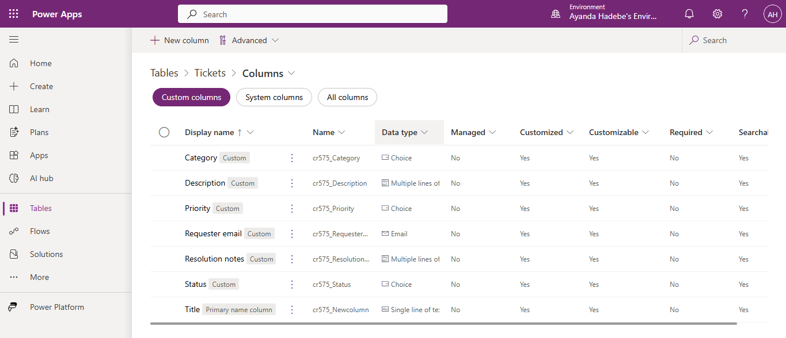

### App

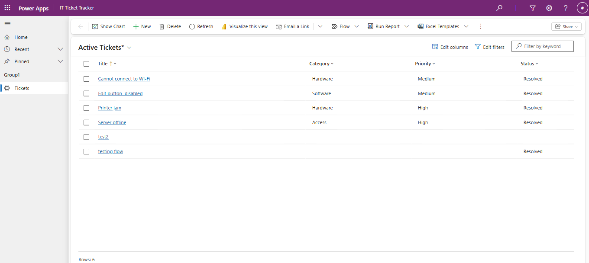

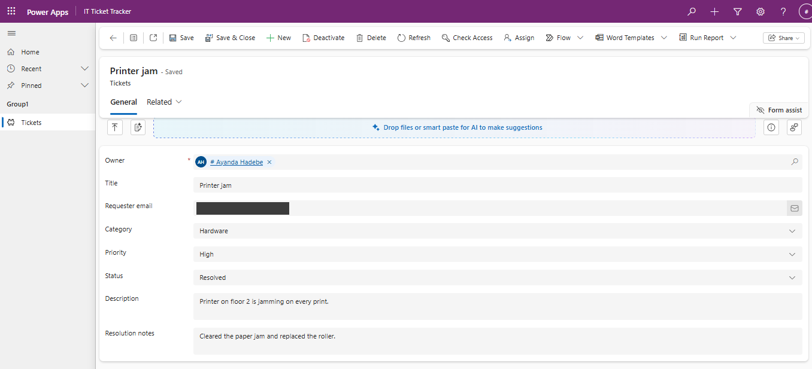

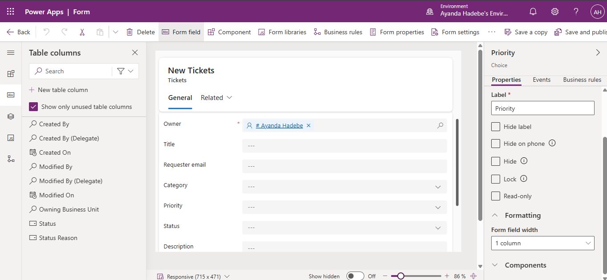

### Flows

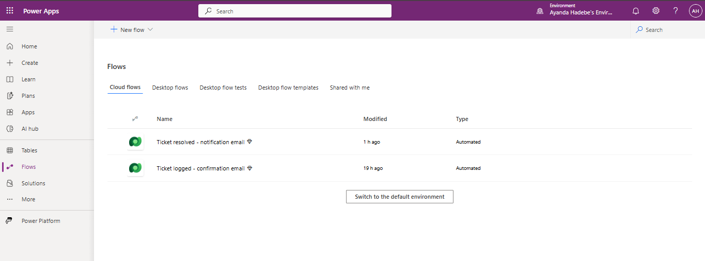

### Flow 1: ticket logged

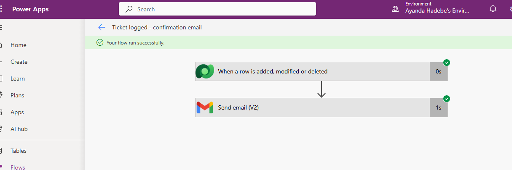

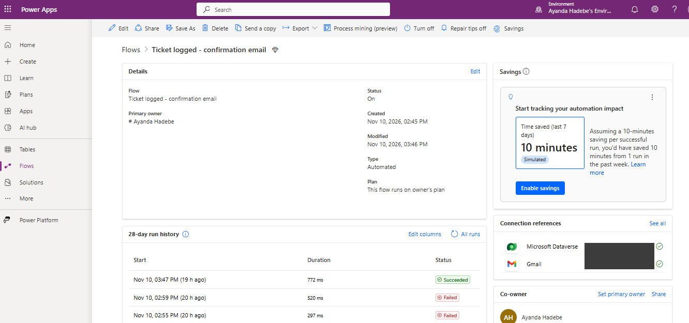

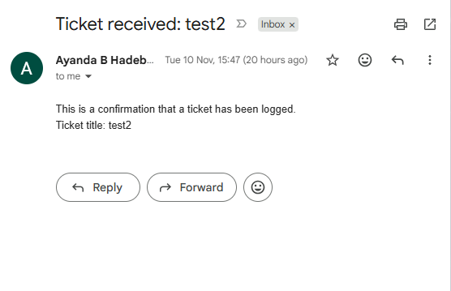

### Flow 2: ticket resolved

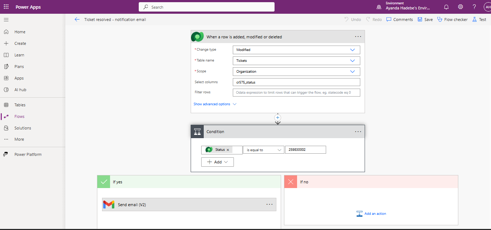

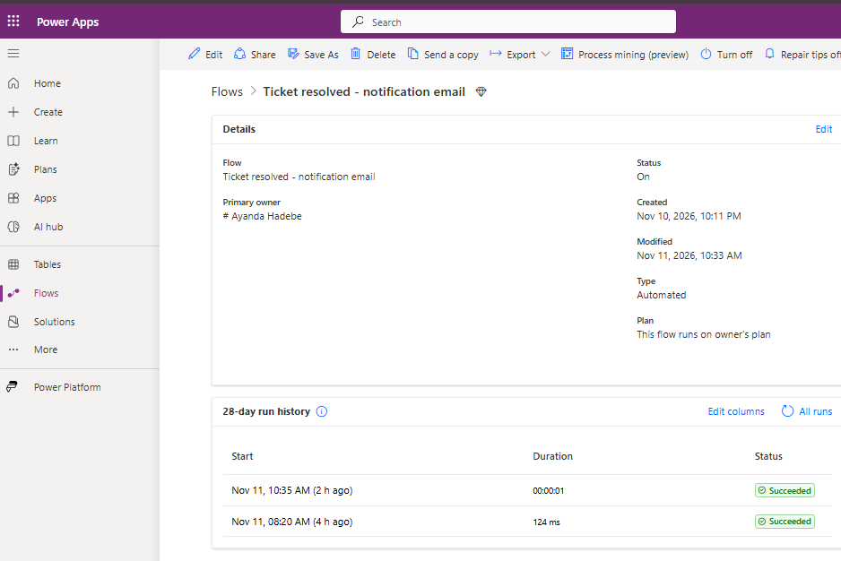

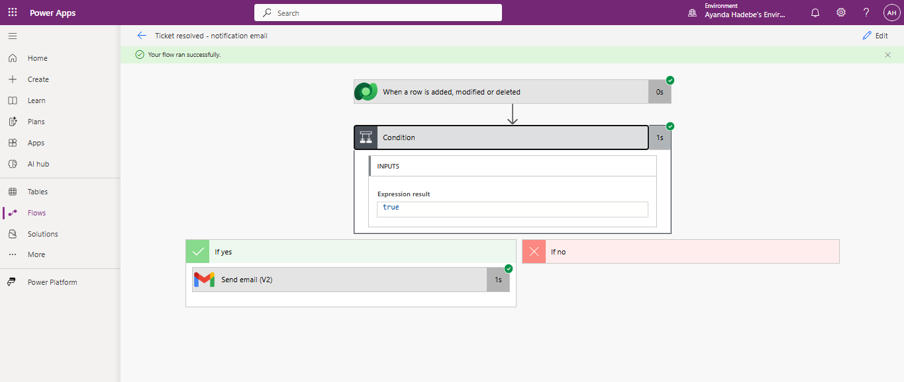

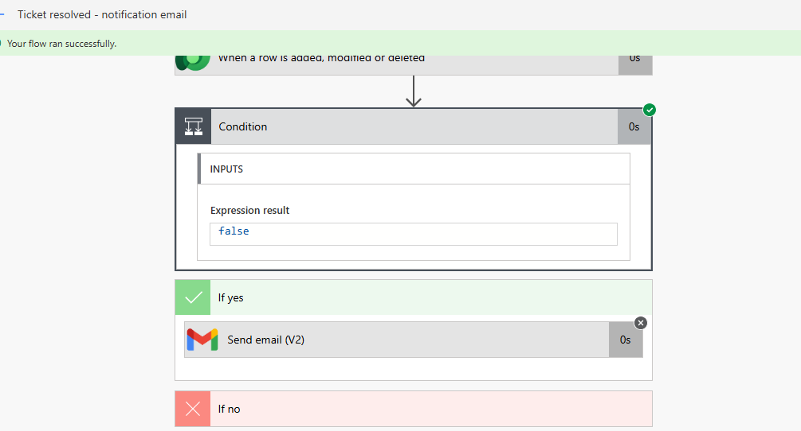

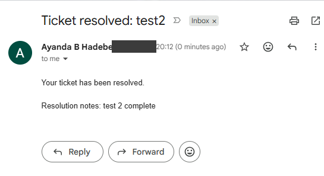

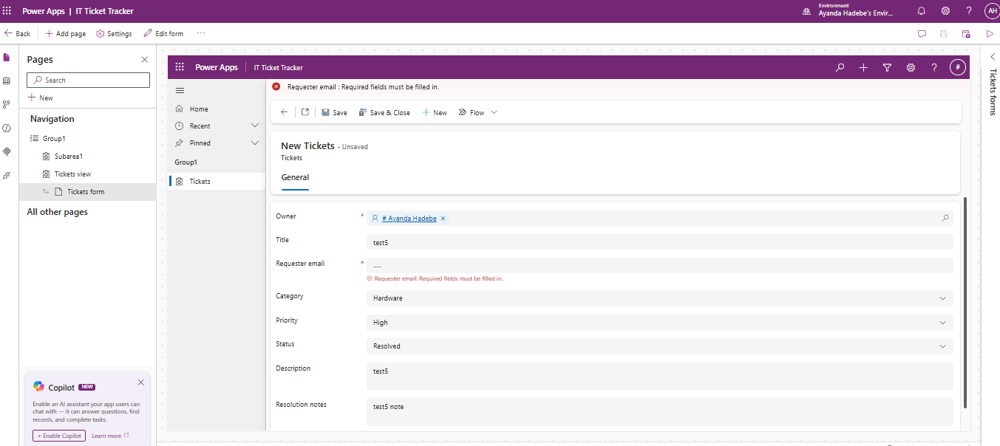

## Data model

**Table: Tickets** (Dataverse)

| Column | Type | Notes |
|---|---|---|
| Title | Single line of text | Primary name column |
| Description | Multiple lines of text | Problem details |
| Category | Choice | Hardware, Software, Access, Other |
| Priority | Choice | Low, Medium, High |
| Status | Choice | New, In Progress, Resolved |
| Requester email | Email | Where notifications are sent |
| Resolution notes | Multiple lines of text | Completed when a ticket is resolved |

Dataverse also adds system columns such as Created On and Owner.

## How it works

**App:** A model-driven app (IT Ticket Tracker) with an Active Tickets view and a main form containing all seven columns.

**Flow 1: Ticket logged - confirmation email**
- Trigger: a row is **added** to Tickets (scope: Organization)
- Action: sends the requester an email confirming the ticket title was logged

**Flow 2: Ticket resolved - notification email**
- Trigger: a row is **modified**, filtered to the Status column only (Select columns: `cr575_status`)
- Condition: Status equals Resolved (choice value `259830002`)
- If yes: sends the requester an email with the Resolution notes
- If no: nothing happens

## Test log

| # | Test | Steps | Expected result | Actual result | Pass / Fail |
|---|---|---|---|---|---|
| 1 | Create a ticket | Click New, fill in all fields except Resolution notes, Save | Ticket appears in Active Tickets | Ticket saved and appeared in the Active Tickets list | Pass |
| 2 | Confirmation email sent | Create a ticket using my own email as Requester email | Flow 1 runs and a confirmation email arrives | Flow 1 ran successfully and the confirmation email arrived | Pass |
| 3 | Confirmation email content | Open the email from test 2 | Subject and body show the correct ticket title | Subject and body showed the correct ticket title | Pass |
| 4 | Status to In Progress | Change a ticket's Status to In Progress, Save | Flow 2 runs, condition is false, no email sent | Flow 2 ran, the condition returned false and no email was sent | Pass |
| 5 | Status to Resolved | Change a ticket's Status to Resolved and add Resolution notes, Save | Flow 2 runs, condition is true, resolved email arrives | Flow 2 ran, the condition returned true and the resolved email arrived | Pass |
| 6 | Resolved email content | Open the email from test 5 | Subject shows the ticket title and body shows the Resolution notes | First run: the body showed the label but no notes. Fixed by inserting the Resolution notes field into the email body, then re-tested: the notes now appear | Fail, fixed, re-tested: Pass |
| 7 | Edit without a status change | Edit only the Description of a ticket, Save | Flow 2 does not run (Select columns filter) | No new run appeared in the run history after waiting; a Status change on the same ticket did start a run | Pass |
| 8 | Missing requester email | Create a ticket with the Requester email empty | Note the result, for example a flow failure | First run: the ticket saved and Flow 1 failed at the Gmail step ("Provide at least one email address"). Fixed by making Requester email a required column. Re-tested: the form now blocks saving and shows a required-field message | Fail, fixed, re-tested: Pass |
| 9 | All choice values available | Open the form and check each choice dropdown | Category, Priority and Status show the correct options | Category showed Hardware, Software, Access and Other. Priority showed Low, Medium and High. Status showed New, In Progress and Resolved | Pass |
| 10 | Regression check | After any change to a flow or form, repeat tests 1, 2 and 5 | All still pass | After making Requester email required and adding Resolution notes to the resolved email, I created a new ticket and resolved it. The ticket saved, the confirmation email arrived, and the resolved email arrived with the note. Both flow runs succeeded | Pass |

## Issues encountered and how I solved them

| Issue | Cause | Fix |
|---|---|---|
| Could not create a Dataverse environment with a personal account | The Power Apps Developer Plan needs a work or school (Microsoft Entra) account | Created a free Azure account, added a user in my own Entra tenant, and signed up for the Developer Plan with it |
| "Create app" failed with a timeout in an incognito window | Third-party cookies and sign-in are blocked in incognito | Used a dedicated Chrome profile for the project |
| Primary column could not be changed to a Choice | The primary name column must stay Single line of text, and its type can't be changed | Renamed it to Title and created a separate Category choice column |
| "Schema name is not unique" when creating the Category choice | A global choice with the same name already existed from an earlier attempt | Reused the existing choice in the new column |
| Mail connector failed ("restricted for new tenants") | Microsoft restricts that connector on new tenants | Switched to the Gmail connector |
| Gmail connection failed ("insufficient authentication scopes") | Not all Google permissions were granted at the consent screen | Retried the sign-in and ticked every requested permission |
| Condition option showed only "Status Reason" | Status Reason is a built-in system column, not my Status choice column | Matched on the choice value (`259830002`) from the trigger output |
| Typed text sent the same email for every ticket | Email fields contained fixed text instead of dynamic content | Replaced them with Requester email and Title from dynamic content |

## Known limitations

- The condition matches the choice **value** `259830002`, so if the Status choice values are changed, the flow must be updated.
- Emails are sent through a personal Gmail connection, which is fine for a demo but not for production. A production version would use a shared mailbox or Office 365 Outlook with a service account.
- Requests with no Requester email are not validated yet.
- Built in a developer environment, which is not meant for production use.

## What I would add next

- A business rule to hide or lock Resolution notes until a ticket is resolved
- A required-field rule for Requester email
- A Power BI report on tickets by category, priority and status
- A canvas app front end for requesters

## Skills demonstrated

Dataverse data modelling, model-driven app configuration, Power Automate (Dataverse triggers, conditions, dynamic content, expressions), structured testing, troubleshooting and documentation.
